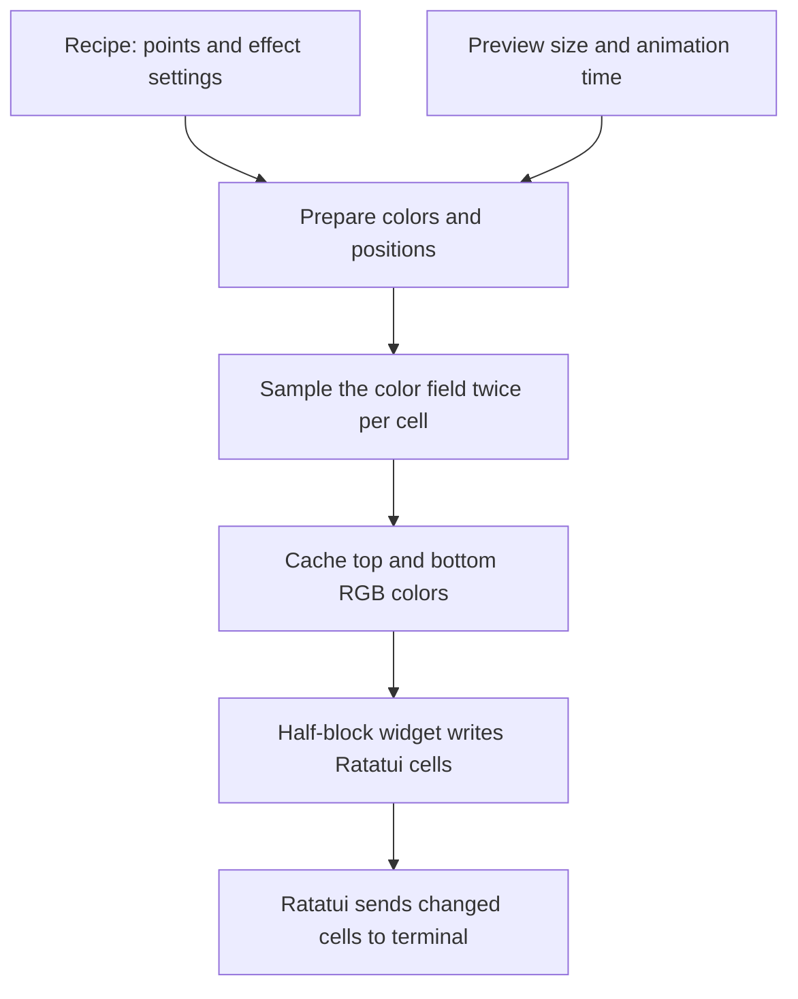

# Colored half-block renderer plan

Status: steps 1 and 2 implemented, plus time-driven distortion and swirl,
a comparison toggle, and pause/resume at a 20 FPS target. Prism and grain
are planned.

## What we are building

A CPU renderer that calculates a color at a position, then shows two colors per
terminal cell. Ratatui manages the screen and input. Our Rust code calculates the
colors. Start with fixed local recipes; connect prompt decisions later.

The first useful result is a static gradient that fills the available area,
resizes correctly, and exits cleanly. Animation follows after that works.

## One terminal cell, two color samples

The character `▀` fills the upper half of a cell with its foreground color. Its
lower half shows the background color:

```text
              terminal cell
          +------------------+
top sample| foreground color |  <- the visible part of ▀
          +------------------+
bottom    | background color |  <- the unfilled part of ▀
sample    +------------------+
```

For an area W columns wide and H rows tall, calculate W × (2H) color samples.
For example, 120 columns × 40 rows becomes a 120 × 80 sample grid: 9,600 samples
stored as 4,800 pairs of RGB colors. It does not become a full-resolution image.

This assumes terminal cells are roughly twice as tall as they are wide, making
half-cells roughly square. Unusual font proportions can stretch the result.
Exact terminal pixel-size detection can be added later if needed.

## Keep calculation and presentation separate



The recipe is independent of Ratatui. The sampler knows nothing about terminals.
The half-block widget knows nothing about gradient math. This lets us test the
math without opening a terminal and swap in other samplers during development.

Suggested files, introduced only as each step needs them:

- `src/main.rs`: initialization and application entry point.
- `src/app.rs`: recipe, cached preview, input, resize handling, and timing.
- `src/gradient.rs`: recipe types, prepared data, and sampling functions.
- `src/color.rs`: sRGB/linear RGB/OKLab conversion functions.
- `src/half_blocks.rs`: RGB-pair cache and Ratatui widget.

## Coordinates and the cell writer

Sample the center of each half-cell, rather than its edge. Coordinates below are
local to the preview area; writing to Ratatui adds the area's screen offset.
The normalized origin is the top-left: x and y both run from 0 to 1.

```text
function buildPreview(preparedGradient, width, height, time):
    if width == 0 or height == 0:
        return emptyPreview

    sampleHeight = 2 * height
    aspect = width / sampleHeight
    frameData = prepareForFrame(preparedGradient, aspect, time)

    for row in 0 .. height:
        for column in 0 .. width:
            x = (column + 0.5) / width
            topY = (2 * row + 0.5) / sampleHeight
            bottomY = (2 * row + 1.5) / sampleHeight

            preview[row, column] = {
                top: sample(frameData, x, topY),
                bottom: sample(frameData, x, bottomY)
            }

    return preview

function paintPreview(preview, area, ratatuiBuffer):
    for each cached color pair at (column, row):
        cell = ratatuiBuffer[area.x + column, area.y + row]
        cell.symbol = "▀"
        cell.foreground = RGB(pair.top)
        cell.background = RGB(pair.bottom)
```

Use a custom Ratatui widget writing directly into its `Buffer`. This is a dense
rectangular field, so we do not need the Canvas widget's shape abstraction.
Use the existing Ratatui/Crossterm dependencies for this first step.

## Implementation steps and completion checks

### 1. Prove the output path

Fill the preview with a fixed top color and a visibly different bottom color.
This step has no gradient math. Keep the existing quit keys.

Complete when each cell shows the intended upper/lower colors, resizing fills
the new area, and tiny or empty areas do not panic. Check orientation and screen
offsets with a small Ratatui `TestBackend` test and inspect it in a real terminal.

### 2. Add a static color field

Use a fixed recipe containing a few normalized positions and RGB colors.
Validate 2–24 points, finite coordinates, and valid parameter ranges before
preparing the recipe. Initially implement only softness; keep other effects off.

Convert point colors into OKLab once when the recipe changes. Calculate a
weighted blend for each sample, then convert it back to display RGB:

```text
function sample(frameData, x, y):
    # Match the site's centered, aspect-adjusted coordinate convention.
    q = ([x, y] - 0.5) * [sqrt(frameData.aspect), 1]

    radius = lerp(0.04, 0.32, softness)

    for each prepared point:
        d2[point] = squaredDistance(q, point.position)

    nearest = minimum(d2)
    totalWeight = 0
    blendedLab = [0, 0, 0]

    for each prepared point:
        weight = exp(-(d2[point] - nearest) / (radius * radius))
        blendedLab += point.labColor * weight
        totalWeight += weight

    lab = blendedLab / totalWeight
    return encodeSRGB(clamp(OKLabToLinearRGB(lab), 0, 1))
```

Prepare point positions with the same aspect correction as q. With animation
disabled this work can be cached until a recipe or size changes. Use fixed-size
scratch storage for the maximum 24 distances; no heap allocations per sample.

Complete when increasing softness visibly broadens color transitions, output
is repeatable, identical-color points produce that color everywhere, known
color conversions round-trip within rounding tolerance, and a symmetric
two-point recipe has the expected midpoint blend.

### 3. Add the effects one at a time

Keep the same pipeline and extend `sample` in this order:

1. Zoom: scale the centered sampling position.
2. Distortion and swirl: port the seeded folds and noise warp.
3. Prism: sample at three nearby positions, taking red, green, and blue from
   separate samples after converting each result to linear RGB.
4. Grain: add a fixed, restrained noise pattern after sRGB conversion.

These preserve the site's ordering. Grain and subtle prism effects may look
rough at terminal resolution; add them only after judging their visible benefit.
Start every new effect at zero so the previous result remains a reference.

Complete when effects can be disabled independently, a seed reproduces its
pattern, and zero-effect output agrees with the static renderer. Use fixed
recipes and numerical sample comparisons, plus real-terminal visual checks.

### 4. Add bounded animation

Begin with a 20 FPS target (50 ms per frame), pause/resume, and one thread. This
is an initial tuning choice, not a promised performance result.

```text
loop:
    if size or recipe changed:
        invalidate prepared data and cached preview

    if animation is playing and frame deadline has arrived:
        time += elapsedSeconds * speed * 0.3
        mark preview dirty

    if preview is dirty:
        rebuild cached color pairs
        terminal.draw(preview and any app text)
        mark preview clean

    wait for input until next animation deadline
    # If paused/static, wait for input without a ticking animation timer.
    handle quit, resize, and pause/resume events
```

Use Crossterm `poll(timeout)` followed by `read()` when input is ready. Avoid a
busy loop. If computation falls behind, skip missed frame deadlines rather than
queuing old frames. Advance time using elapsed time, not frame count. Pausing
must not cause animation time to jump when resumed.

Compute drifting point positions once per frame. Ratatui still needs the cached
preview painted on every application draw, even when only some app text changed:
its buffer diffing handles which cells actually reach the terminal.

Complete when static/paused mode does not continuously compute frames, animation
remains responsive to quit and resize, and CPU use and frame durations have been
measured at representative terminal sizes.

## Performance decisions

- Work scales with sample count × point count; prism adds two field evaluations.
- Reuse the RGB-pair vector; resize it only when the preview dimensions change.
- Cache recipe color conversions and frame-wide point preparation.
- Measure gradient calculation and terminal drawing separately. Terminal output
  may dominate once most cells change each frame.
- If frame times exceed the initial 50 ms budget, first lower FPS or simplify
  costly effects. Add workers or parallel sampling only if measurements justify
  the additional complexity. Measure the terminal emulator as well as Amber
  when assessing total resource use.

## Boundaries for this iteration

Require a terminal with truecolor and Unicode half-block support for the intended
appearance. A reduced-color fallback can follow if needed. Defer Jev calls,
prompt-to-recipe mapping, URL serialization, high-resolution export, and GPU or
terminal image protocols. Keep recipe fields descriptive so the later decision
pipeline can supply the same renderer without knowing how terminal cells work.

## API references

- Ratatui cells, symbols, foreground and background colors:
  https://docs.rs/ratatui/latest/ratatui/buffer/struct.Cell.html
- Ratatui buffer diffing and rendering lifecycle:
  https://docs.rs/ratatui/latest/ratatui/struct.Terminal.html
- Crossterm input polling with a timeout:
  https://docs.rs/crossterm/latest/crossterm/event/fn.poll.html
- Original Mesh shader used as the mathematical reference:
  https://mesh.iamnoman.com/_next/static/chunks/02qzsr1wjc9~..js
